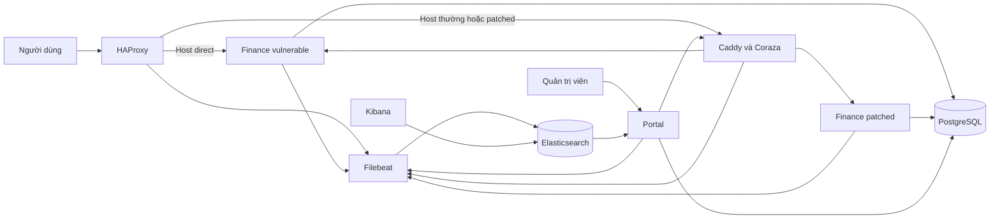
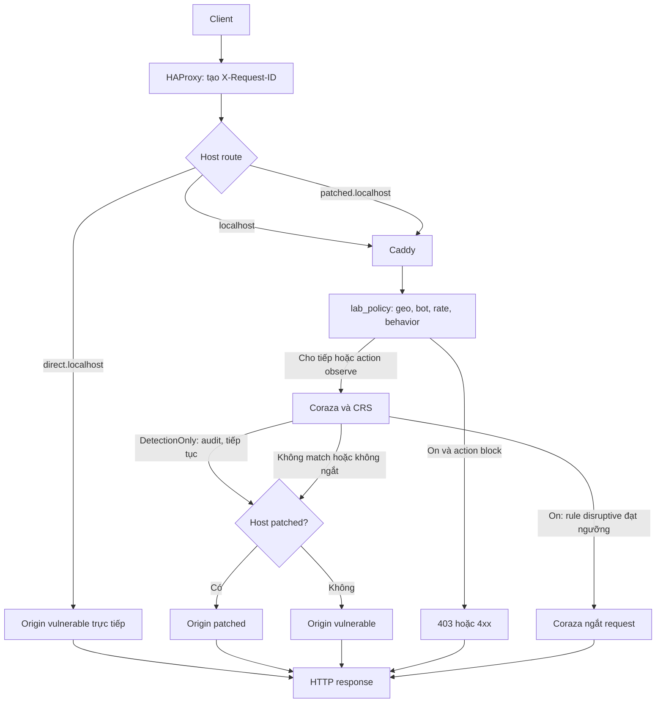
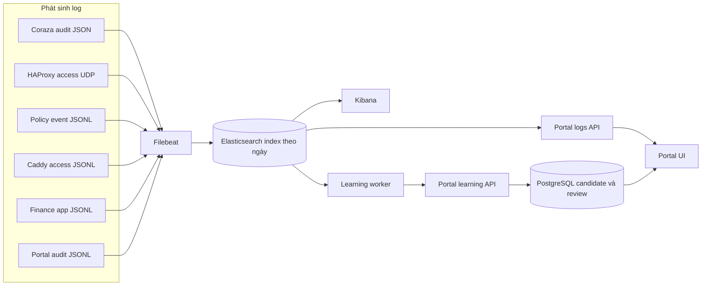
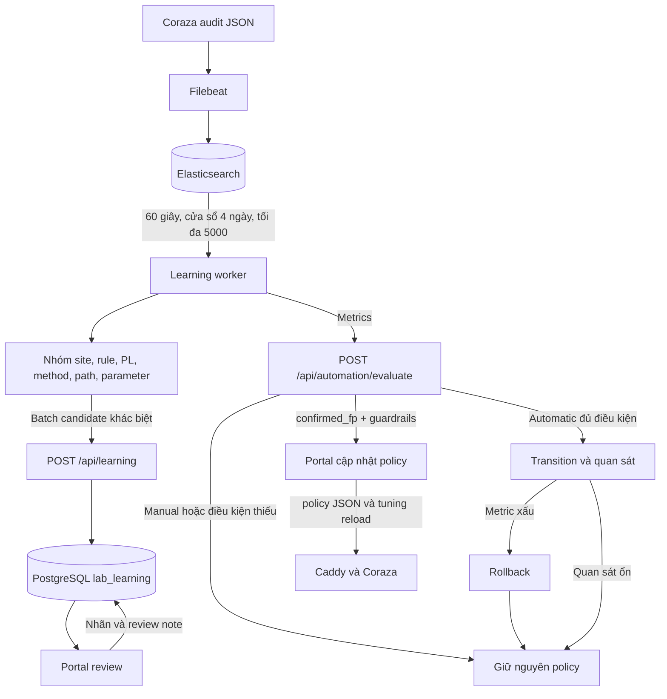

# Kiến trúc và vận hành WaF

Tài liệu này mô tả luồng theo Compose và mã nguồn hiện tại. Nhãn **Mã/cấu hình** không xác nhận service đã nạp cấu hình. Trong lần khảo sát, `docker compose -f lab/docker-compose.yml ps --format json` trả danh sách rỗng; runtime vì vậy chưa được xác nhận.

## 1. Thành phần chính



HAProxy là điểm vào HTTP. `direct.localhost` chọn origin vulnerable trực tiếp; `localhost` chọn backend có WAF và fallback; `patched.localhost` chọn WAF rồi origin patched. Portal không nằm trên đường request website: nó quản trị policy và đọc log. PostgreSQL lưu policy/candidate; Filebeat chuyển log tới Elasticsearch.

| Cạnh/luồng | Căn cứ | Trạng thái |
| --- | --- | --- |
| Client → HAProxy → backend theo Host | `lab/docker-compose.yml`, `lab/edge/haproxy.cfg` | Xác nhận từ mã/cấu hình |
| direct → origin vulnerable | ACL `host_direct`, backend `finance_direct` trong `lab/edge/haproxy.cfg` | Xác nhận từ mã/cấu hình |
| Host thường/patched → WAF → finance | `lab/edge/haproxy.cfg`, `lab/waf/Caddyfile` | Xác nhận từ mã/cấu hình |
| Portal → PostgreSQL và WAF admin | `lab/docker-compose.yml`, `lab/portal-ui/server.mjs` | Xác nhận từ mã/cấu hình |
| Elasticsearch → Kibana/worker | `lab/docker-compose.yml` | Xác nhận từ mã/cấu hình |
| Container đang chạy và topology hiệu lực | `docker compose ... ps` trả danh sách rỗng | Chưa xác minh runtime |

## 2. Request, kiểm tra và chặn



HAProxy tạo/ghi đè `X-Request-ID`, gửi ID trong request và response; access log ghi cùng ID. Với đường WAF, Caddy gọi `lab_policy` trước `coraza_waf` theo `route` trong Caddyfile. Policy handler đọc JSON mỗi request, xóa header điều khiển từ client rồi đặt header nội bộ. Coraza nạp CRS sau rule lab và tuning. DetectionOnly khiến Coraza không ngắt; policy module cũng chuyển các quyết định block thành observe. Ở mode On, từng rule behavior vẫn có thể đặt action `observe`; Coraza chặn khi rule disruptive hoặc anomaly score đạt ngưỡng. Direct bỏ qua cả hai lớp.

`Blocking PL` là mức paranoia dùng làm ngưỡng chặn; `Detection PL` cho phép CRS chạy rule ở mức cao hơn để ghi nhận. Module giới hạn giá trị hợp lệ 1–4 và mặc định fallback lần lượt là 1 và 2 khi đọc policy sai. Rule `100002`/`100003` đưa hai giá trị vào transaction Coraza. Mode `DetectionOnly` không ngắt request ở Coraza; policy module cũng observe thay vì chặn. Trong mode `On`, action `observe` của từng policy behavior vẫn chỉ ghi nhận.

| Cạnh/luồng | Căn cứ | Trạng thái |
| --- | --- | --- |
| HAProxy tạo X-Request-ID, chọn route và chuyển request | `lab/edge/haproxy.cfg` | Xác nhận từ mã/cấu hình |
| `lab_policy` chạy trước Coraza | Thứ tự trong `lab/waf/Caddyfile` | Xác nhận từ mã/cấu hình |
| CRS nạp sau rule lab và tuning | `load_owasp_crs` cùng `Include` trong `lab/waf/Caddyfile` | Xác nhận từ mã/cấu hình |
| DetectionOnly đặt `ctl:ruleEngine=DetectionOnly`; On giữ disruptive rule | `lab/waf/config/lab-rules.conf` | Xác nhận từ mã/cấu hình |
| Thứ tự policy | `ServeHTTP`: geo → bot → rate IP/CIDR → login threshold → 404 threshold → sequential docs → upstream/counter | Xác nhận từ `lab/waf/policy-module/policy.go` |
| Bot heuristic | Parser UA nhận dạng + fanout đạt ngưỡng; token bucket áp dụng với UA được nhận dạng là bot | Xác nhận từ mã/cấu hình; không xác thực danh tính bot thật |
| Behavior | Login đếm 401 sau upstream; not-found đếm 404; sequential docs so ID kế tiếp | Xác nhận từ mã/cấu hình |
| Policy hiệu lực tại service | Runtime không có container để đọc | Chưa xác minh runtime |

### Diễn giải quyết định

- Coraza block cần audit cùng ID có rule và `transaction.is_interrupted=true`.
- Policy module block ghi `event.dataset=waf.behavior`, `event.kind=blocked`, action `block`; rule tạo 403 hoặc 429 tùy loại.
- Origin có thể trả 401/403/404; HAProxy cũng có thể trả lỗi proxy/server. Status 403/429 riêng lẻ không chỉ ra thành phần quyết định.
- Đối chiếu ID ở HAProxy, Coraza hoặc policy event, rồi finance app `event.outcome` để xác định kết quả.

### Cập nhật policy

Portal lưu policy trong PostgreSQL `lab_policy` rồi xuất JSON dùng chung; policy handler đọc JSON mỗi request. Khi tuning/IP policy đổi, portal tạo rule file và gọi Caddy admin API để reload. Đây là đường đi trong mã; lượt này không xác nhận runtime đã nạp.

## 3. Nguồn log, thu thập và tra cứu



Filebeat khai báo filestream cho `/var/log/lab/*.jsonl`, `/var/log/nuclei/*.jsonl` và UDP `:5140`; output là `waf-lab-%{+yyyy.MM.dd}`. Cấu hình không chứng minh event đã được chuyển. Portal logs API truy vấn Elasticsearch; UI không đọc file log trực tiếp. Worker lấy audit Coraza để tạo candidate qua Portal learning API; HAProxy access được truy vấn riêng làm metric automation.

| Nguồn → trường chính | Thu thập | Portal / nơi dùng | Trạng thái |
| --- | --- | --- | --- |
| Coraza `coraza-audit.jsonl`: transaction, messages/rule, interruption, X-Request-ID | Filebeat filestream | Portal nhật ký; worker candidate | Xác nhận từ mã/cấu hình |
| HAProxy access: `http.request.id`, status, `lab.route/backend/server`, IP, method/path | UDP tới Filebeat `:5140` | Portal ghép context; worker metric riêng | Xác nhận từ mã/cấu hình |
| Policy `waf-policy.jsonl`: dataset/action/kind, rule, request ID | Filebeat filestream | Portal decision và correlation | Xác nhận từ mã/cấu hình |
| Caddy access `waf-access.jsonl` | Filebeat filestream | Portal nhận dạng nhóm WAF | Xác nhận từ mã/cấu hình |
| Finance `finance-*.jsonl`: dataset/action/outcome, ID, path, policy version | Filebeat filestream | Portal xác định kết quả app khi có outcome | Xác nhận từ mã/cấu hình |
| Portal `portal.jsonl`: policy/learning/review events | Filebeat filestream | Portal log; Kibana | Xác nhận từ mã/cấu hình |
| Portal API `/api/logs`, `/api/logs/trace`, `/api/overview/logs` | `lab/portal-ui/server.mjs`, `logs.mjs`, `public/app.js` | Hiển thị thời gian, IP, method/path, status, loại event, rule, ID và decision/correlation; trang 25 dòng, trace tối đa 200 | Xác nhận từ mã/cấu hình |
| Kibana → Elasticsearch `waf-lab-*` | Compose và Kibana config | Discover/dashboard | Xác nhận từ mã/cấu hình |
| Event đã được ingest/index hiện có | Runtime Docker trống; không truy vấn ES | — | Chưa xác minh runtime |

Portal giữ nguồn log thành document riêng và ghép ở response API. Coraza lấy ID từ transaction request headers; HAProxy dùng `http.request.id`; app ghi `http.request.id`. Tuyến `direct.localhost` không qua WAF nên không tạo Coraza audit; nếu thiếu ID hoặc một nguồn chưa tới ES, correlation không đầy đủ và không chứng minh request không tới backend. Trace Portal lấy tối đa 200 kết quả; trang log có 25 dòng/trang. Worker truy vấn tối đa 5.000 audit hits và đánh dấu truncated khi tổng lớn hơn số hits hoặc candidate vượt 100. `setup.ilm.enabled: false`; retention không được xác nhận. Chậm ingest có thể khiến worker bỏ lỡ dữ liệu ngoài cửa sổ truy vấn ở tick sau; mã không có dead-letter queue. Incident/report chuyên biệt **chưa triển khai**; review log theo request ID không phải incident case management.

## 4. Learning và automation



Worker đọc audit bốn ngày, tối đa 5.000 hits; nhóm theo site, rule, PL, method, path, parameter. Key là hash từ các chiều đó. `count` là số request ID khác nhau (thiếu ID thì timestamp + dimension); `days` là số ngày UTC; tối đa năm sample IDs. `estimated_blocks` đếm match ở PL cao hơn Blocking PL, không phải số lần block thực tế. Candidate được gửi theo batch tối đa 100 và digest hiện tại bỏ qua lần gửi lặp nếu không đổi.

Portal lưu candidate ở PostgreSQL và UI tải tối đa 200 hàng. Nhãn gồm candidate, needs_review, confirmed_fp, dismissed; confirmed_fp cần review note có bằng chứng. Automation mặc định trong mã là manual. Nâng PL chỉ xét ở automatic khi có ít nhất 10.000 request trong 7 ngày, ít nhất 30 request gần đây, flow test đã xác nhận, không còn false positive nghiêm trọng chưa xử lý; Detection PL phải cao hơn Blocking PL trước khi tăng PL. Auto-exception yêu cầu candidate `confirmed_fp`, site vulnerable, path nằm trong allowlist, ít nhất 30 request trên ít nhất 3 ngày trải qua 48 giờ, target hợp lệ và không có rule nghiêm trọng khác; ngoại lệ hết hạn sau 24 giờ. Rollback theo transition 15 phút: lỗi trên max(5%, 2×baseline) hoặc block trên max(10%, 2×baseline) sẽ rollback; nếu sau 15 phút có dưới 10 request cũng rollback. Đây là điều kiện trong mã, chưa chứng minh runtime. Policy hiệu lực runtime chưa xác minh.

| Cạnh/luồng | Căn cứ | Trạng thái |
| --- | --- | --- |
| Audit → ES → worker mỗi 60 giây/4 ngày/5000 | `lab/observability/filebeat.yml`, `lab/learning-worker/worker.mjs`, Compose | Xác nhận từ mã/cấu hình |
| Group, dedupe, sample IDs, estimated_blocks | `lab/learning-worker/learning.mjs` | Xác nhận từ mã/cấu hình |
| Worker → API → PostgreSQL | `worker.mjs`, `lab/portal-ui/server.mjs`, bảng `lab_learning` | Xác nhận từ mã/cấu hình |
| Review nhãn/evidence trên Portal | `server.mjs`, `lab/portal-ui/public/app.js` | Xác nhận từ mã/cấu hình |
| Evaluate, auto-exception, promotion và rollback | `server.mjs`, `lab/portal-ui/automation.mjs` | Xác nhận từ mã/cấu hình; chưa xác minh runtime |
| Candidate được lưu trong PG hiện tại | Không có service runtime để đối chiếu | Chưa xác minh runtime |

## 5. Chạy lab, demo và khôi phục

Yêu cầu Docker Compose v2, khoảng 6 GB RAM và dung lượng trống như mô tả ở [hướng dẫn lab](../lab/README.md). Từ thư mục repo:

```sh
docker compose -f lab/docker-compose.yml config --quiet
docker compose -f lab/docker-compose.yml up --build -d
docker compose -f lab/docker-compose.yml ps
```

Website: `http://127.0.0.1:8080`; Portal: `http://127.0.0.1:8090`; Kibana: `http://127.0.0.1:5601`. HAProxy định tuyến dựa Host `localhost`, `direct.localhost`, `patched.localhost`. Dừng bằng `docker compose -f lab/docker-compose.yml stop`; tránh `down -v` nếu cần giữ dữ liệu.

Template độc lập nằm trong `lab/nuclei-templates/`; script allowlist, giới hạn target và rate ở `lab/scripts/run-nuclei.ps1`. Fixture command chỉ phân loại marker, không chạy shell. Xem lệnh và kết quả mong đợi trong [lab README](../lab/README.md) và [scenario](scenarios.md). Bài có đổi policy cần snapshot và khôi phục giá trị hiệu lực; tài liệu này không yêu cầu chạy bài thử.

## 6. Xử lý sự cố

| Triệu chứng | Kiểm tra |
| --- | --- |
| WAF không khỏe hoặc route đổi | `docker compose ... ps`; HAProxy logs; so `lab.route`, `lab.backend`, `lab.server`. `bypass` có thể là direct hoặc failover. |
| Thiếu Coraza audit | Xác nhận request thực sự tới WAF, mode, audit event, mount `lab/runtime/logs`, Filebeat input. |
| Log không tới Elasticsearch | Filebeat logs/registry và Elasticsearch health/index; cấu hình không chứng minh ingest. |
| Không ghép request | So ID tại HAProxy, Coraza transaction headers, finance `http.request.id`; xét thiếu ID hoặc ingest trễ. |
| HTTP 403/429 chưa rõ nguồn | Tìm Coraza `is_interrupted`, policy `kind=blocked`, finance `event.outcome`, HAProxy status cùng ID. |
| Worker ngừng hoặc query cắt | Compose status/worker logs, heartbeat, cửa sổ 4 ngày, 5000 hit/100 candidate và `truncated`. Candidate vắng không chứng minh không có event. |

Đổi mode/action/tuning qua Portal. Khi kiểm thử thay đổi, lưu policy hiệu lực trước và xác nhận sau khôi phục. Không xóa log hoặc volume để xử lý thiếu dữ liệu. Incident/reporting chuyên biệt hiện chưa có.
